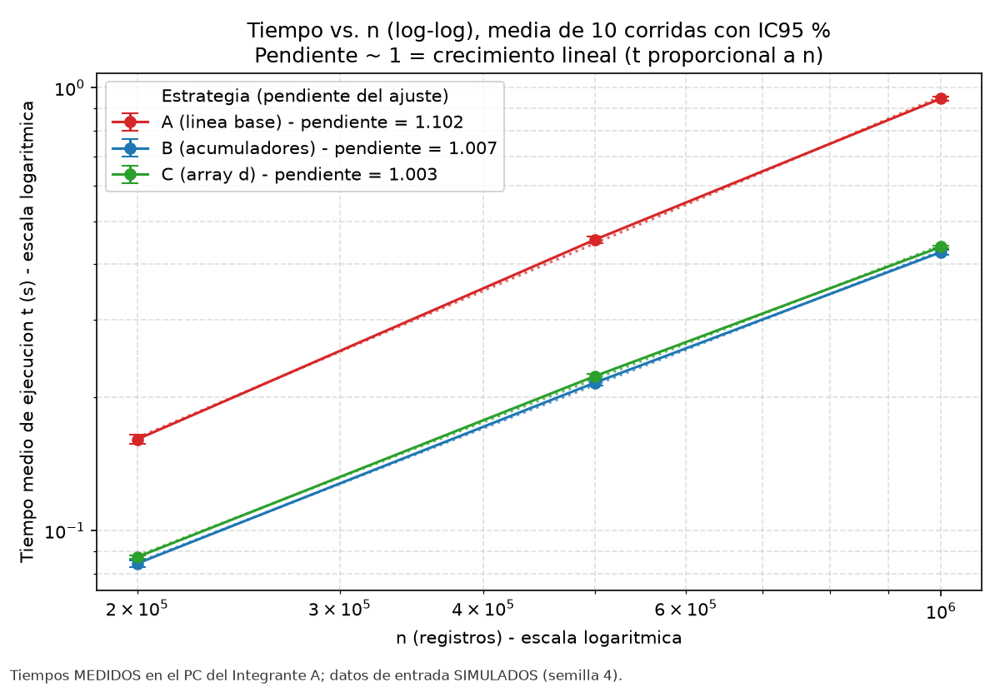
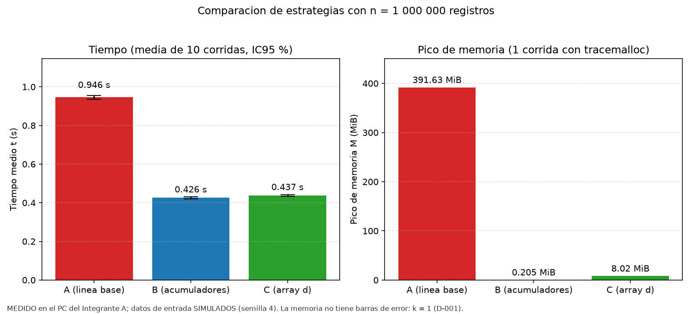

# Informe científico breve — Equipo __

**Título:** · **Integrantes:** · **Fecha:** · **Repositorio:**

## Resumen (≤ 150 palabras)
Problema, método, resultado principal con cifras y unidades, conclusión.

## 1. Introducción

**Problema empresarial (caso simulado).** SaludNet IPS monitorea los sensores ambientales de 200 salas de vacunas. El
tablero que resume sus lecturas (temperatura media y máxima por sensor) **falla con archivos grandes por falta de memoria**
en un servidor virtual de **2 GiB** (README §1). La versión actual (`src/linea_base.py`, estrategia A) convierte cada línea
del CSV en un diccionario y los guarda **todos a la vez** en una lista.

**Pregunta de investigación.** ¿Cómo cambian el **pico de memoria (MiB)** y el **tiempo de ejecución (s)** cuando se cambia
la **estrategia de procesamiento** (A = línea base, B = línea por línea, C = formato compacto) y el **número de registros n**
(200 000, 500 000 y 1 000 000), manteniendo el mismo equipo, la versión de Python, los datos de entrada (semilla 4) y el plan
de energía?

**Principios físicos involucrados.**

| Magnitud | Fórmula | Unidad | Papel en el problema |
|---|---|---|---|
| Memoria | M ≈ n · m (m = bytes por registro guardado) | B; 1 MiB = 2²⁰ B = 1 048 576 B; 2 GiB = 2 147 483 648 B | La RAM guarda cada bit en una celda física y hay un número limitado de celdas. Si M supera los 2 GiB del servidor, el tablero falla. |
| Memoria por registro | m = M / n | B/registro | Medición preliminar de A (Clase 3): 117.5 MiB con n = 300 000 → m ≈ 411 B/registro. Una temperatura sola cabe en 8 B. |
| Frecuencia y periodo | T = 1 / f | Hz = 1/s; s | f = 2.2 GHz (reportada por psutil) → T ≈ 0.455 ns por ciclo. |
| Ciclos de reloj | N = f · t | ciclos (sin unidad) | Estima cuánto trabajo hace el procesador; N / n son los ciclos por registro. Crear diccionarios y textos cuesta ciclos. |
| Energía | E = P · t | J | **No se mide** (no hay RAPL en Windows); no se afirma ahorro de energía. |

**Estimación de partida (no medida):** con m ≈ 411 B/registro, 2 GiB alcanzan para ≈ 2 147 483 648 B ÷ 411 B ≈
**5.2 millones de registros**, sin contar el sistema operativo ni el resto del tablero.

## 2. Hipótesis

Copiadas de `docs/hipotesis.md` **sin modificarlas** después de ver los datos. Variables controladas en las tres: mismo
equipo, Python 3.14.3, plan "Turbo" con cargador, mismos datos (semilla 4, 200 sensores) y programas cerrados.

- **H1.** **Si** se usa la estrategia B (línea por línea) en vez de la A (línea base) con n = 1 000 000, **entonces** el pico
  de memoria (MiB) **disminuirá** más de un 90 % (M_B < 0.10 × M_A), **porque** B solo guarda suma, cantidad y máxima de los
  200 sensores en vez de guardar los n registros como diccionarios con textos. *Se refuta si* M_B ≥ 0.10 × M_A.
- **H2.** **Si** n aumenta 5 veces (de 200 000 a 1 000 000), **entonces** el pico de memoria (MiB) de A y de C **aumentará**
  aproximadamente 5 veces (cociente entre 4 y 6) y el de B **casi no cambiará** (cociente entre 0.8 y 1.2), **porque** A y C
  guardan cada registro (A ≈ 411 B, C ≈ 8 B por temperatura) y B no guarda ninguno. *Se refuta si* algún cociente queda
  fuera de su rango.
- **H3.** **Si** se usa la estrategia B en vez de la A con n = 1 000 000, **entonces** el tiempo de ejecución (s)
  **disminuirá** al menos un 20 % (t_B ≤ 0.80 × t_A, promedio de 10 corridas sin tracemalloc), **porque** B no crea un
  diccionario por registro ni recorre una lista de n elementos por segunda vez (menos operaciones = menos ciclos, N = f · t).
  *Se refuta si* t_B > 0.80 × t_A o si B resulta más lenta que A.

## 3. Método

### 3.1 Estrategias comparadas
Las tres reciben el mismo CSV y devuelven `{id_sensor: (media, máxima)}`.

| Id | Archivo | Qué guarda en memoria |
|---|---|---|
| A — línea base | `src/linea_base.py` | **Todas** las líneas como diccionarios con 4 textos (línea 30), y luego listas de temperaturas por sensor. |
| B — línea por línea | `src/estrategia_b.py` | Solo **suma, cantidad y máxima** de cada uno de los 200 sensores; cada línea se descarta después de leerla. La media se calcula al final (suma ÷ cantidad). |
| C — formato compacto | `src/estrategia_c.py` | Todas las temperaturas, pero como números de 8 B en un `array('d')` por sensor, sin diccionarios ni textos. |

**Corrección:** antes de medir, `ejecutar_experimento.py` comprueba para cada n que B y C dan el mismo resultado que A
(tolerancia `abs_tol = 1e-9`), y `pruebas/test_correccion.py` lo comprueba con 3 pruebas (Durman, R2).

### 3.2 Variables
Detalle en `docs/variables.md`.
- **Independientes:** estrategia (A, B, C) y tamaño de entrada n (200 000, 500 000 y 1 000 000 registros).
- **Dependientes:** pico de memoria M (MiB, principal), tiempo t (s) y uso de CPU U = t_CPU / t (%). Temperatura (°C) y
  energía (J) **no disponibles** en este equipo.
- **Controladas:** equipo, versión de Python, alimentación (cargador + plan "Turbo"), programas abiertos, datos de entrada
  (semilla 4) y estado de la memoria (`gc.collect()` + calentamiento).

### 3.3 Entorno
PC del Integrante A, sesión del 25/11/2026 (`docs/entorno.md`, mismo resultado que `diagnostico_entorno.py` del 18/11/2026).

| Característica | Valor |
|---|---|
| Sistema operativo | Windows 11 (10.0.26200), AMD64 |
| Procesador | Intel64 Family 6 Model 186, 8 núcleos físicos / 12 lógicos |
| RAM | 15.63 GiB (54.5 % usada antes de medir, ver D-003) |
| Python | 3.14.3 |
| Frecuencia reportada | 2200 MHz (psutil no ve el turbo) |
| Alimentación | Cargador conectado, plan "Turbo", suspensión desactivada durante la medición |
| Temperatura / energía | No disponibles (sin sensor expuesto y sin RAPL) |

### 3.4 Instrumentos y su resolución

| Instrumento | Mide | Resolución |
|---|---|---|
| `time.perf_counter()` | Tiempo t (s) | 1 × 10⁻⁷ s (100 ns), según `time.get_clock_info` en este PC |
| `time.process_time()` | Tiempo de CPU del proceso (s) | Python reporta 1 × 10⁻⁷ s, pero en los datos avanza de a **15.625 ms** (1/64 s, el reloj de Windows); por eso `uso_cpu_pct` varía entre 72 % y 115 % por corrida (`docs/calidad_datos.md`) |
| `tracemalloc` | Pico de memoria reservada por Python (MiB) | 1 B. No ve la memoria del intérprete ni la del sistema; vuelve lento el programa (D-001) |
| `psutil` | Memoria total del proceso (`rss_mib`), frecuencia, CPU del sistema | Frecuencia fija en 2200 MHz; el monitor (`herramientas/monitor_sistema.py`) toma una muestra cada 1 s |

### 3.5 Protocolo
Resumen de `docs/protocolo.md` (versión 2).
1. **Preparación:** cargador conectado, plan "Turbo", programas cerrados, RAM revisada, suspensión en "Nunca" y PC sin usar.
2. **Pruebas de corrección** (`python -m unittest discover -s pruebas`) y **prueba de humo** (`--rapido`). Si fallan, no se mide.
3. **Monitor del sistema** en otra terminal y **experimento formal** (`python -m experimentos.ejecutar_experimento`).
4. **Tamaños:** 200 000, 500 000 y 1 000 000 registros (datos simulados, semilla 4).
5. **Repeticiones:** 10 de tiempo por combinación y 1 de memoria aparte con tracemalloc (D-001: el pico salió idéntico en
   3 corridas de la Clase 3). Total esperado: 90 + 9 = **99 filas**.
6. **Calentamiento:** 1 ejecución por estrategia que no se registra.
7. **Orden aleatorio** de las corridas con semilla 42, para que un cambio del PC a mitad del experimento no afecte siempre a
   la misma estrategia.
8. **Calidad:** CV ≤ 10 % por combinación; atípicos (Tukey) se reportan y solo se excluyen con causa documentada.

El experimento se ejecutó el 25/11/2026 de 11:39:44 a 11:40:46 (**62 s**) y produjo las 99 filas esperadas
(`docs/calidad_datos.md`).

## 4. Resultados

**Origen de cada dato:**
- **SIMULADO:** los datos de entrada (lecturas de 200 sensores generadas por `src/generar_datos.py` con semilla 4).
- **MEDIDO:** tiempos (s) y picos de memoria (MiB), en el PC del Integrante A el 25/11/2026 (`resultados/resultados.csv`,
  99 filas = 90 de tiempo + 9 de memoria; entorno en `docs/entorno.md`).
- **ESTIMADO:** ciclos por registro N / n = f · t / n, con f = 2.2 GHz reportada por psutil (no ve el turbo).

**Cómo se calculó** (`python -m experimentos.analizar_resultados`):
- **Tiempo:** solo las 10 corridas con `medicion_memoria = no` por estrategia y n. La corrida de memoria se excluye porque
  tracemalloc infla su tiempo (D-001). Media, desviación estándar muestral s, CV = s / media × 100 e
  IC95 % = media ± 2.262 × s / √10 (t de Student, gl = 9).
- **Memoria:** solo la corrida con `medicion_memoria = si` (k = 1). No tiene desviación ni IC95 % porque una sola medición
  no permite estimar la variación; se justifica porque el pico salió idéntico en 3 corridas previas (D-001).

### 4.1 Tabla resumen

| Estrategia | n | Tiempo medio (s) | s (s) | CV (%) | IC95 % del tiempo (s) | Pico de memoria (MiB) | Ciclos por registro (estimados) |
|---|---|---|---|---|---|---|---|
| A (línea base) | 200 000 | 0.1608 | 0.0055 | 3.41 | [0.1569; 0.1648] | 78.183 | 1 769 |
| A (línea base) | 500 000 | 0.4540 | 0.0119 | 2.62 | [0.4455; 0.4625] | 195.637 | 1 998 |
| A (línea base) | 1 000 000 | 0.9458 | 0.0128 | 1.36 | [0.9367; 0.9550] | 391.632 | 2 081 |
| B (acumuladores) | 200 000 | 0.0843 | 0.0020 | 2.34 | [0.0829; 0.0858] | 0.205 | 928 |
| B (acumuladores) | 500 000 | 0.2159 | 0.0043 | 2.01 | [0.2128; 0.2190] | 0.205 | 950 |
| B (acumuladores) | 1 000 000 | 0.4257 | 0.0081 | 1.91 | [0.4198; 0.4315] | 0.205 | 936 |
| C (array d) | 200 000 | 0.0872 | 0.0010 | 1.18 | [0.0865; 0.0879] | 1.761 | 959 |
| C (array d) | 500 000 | 0.2234 | 0.0040 | 1.79 | [0.2205; 0.2262] | 4.110 | 983 |
| C (array d) | 1 000 000 | 0.4374 | 0.0048 | 1.09 | [0.4340; 0.4408] | 8.022 | 962 |

Los CV del tiempo están entre **1.09 % y 3.41 %**: todas las combinaciones cumplen el criterio del protocolo (CV ≤ 10 %).
Tabla completa (con mínimo, máximo, bytes por registro y pendientes) en `resultados/resumen_estadistico.csv`.

### 4.2 Gráfico 1: tiempo vs. n (log-log)

[`resultados/grafico_1_tiempo_vs_n_loglog.png`](../resultados/grafico_1_tiempo_vs_n_loglog.png). Pendiente del ajuste
lineal de log(t) vs. log(n): **A = 1.102**, **B = 1.007**, **C = 1.003**. Una pendiente cercana a 1 significa que el tiempo
crece en proporción directa a n (si n se multiplica por 5, t también). Las barras de IC95 % son más pequeñas que los marcadores.

### 4.3 Gráfico 2: comparación con n = 1 000 000

[`resultados/grafico_2_comparacion_n1M.png`](../resultados/grafico_2_comparacion_n1M.png). Con n = 1 000 000, B tarda el
**45.0 %** del tiempo de A y C el **46.2 %**; el pico de memoria de B es el **0.052 %** del de A y el de C el **2.05 %**.

### 4.4 Decisión sobre las hipótesis

Detalle del criterio y de los cálculos en `docs/hipotesis.md` (sección "Evaluación de las hipótesis").

| Id | Predicción | Resultado (MEDIDO) | Criterio | Estado |
|---|---|---|---|---|
| H1 | M_B < 0.10 × M_A con n = 1 000 000 | 0.205 MiB < 39.163 MiB; M_B / M_A = 0.000523 | Comparación directa, k = 1 (D-001) | **Se confirma** |
| H2 | M(1 000 000) / M(200 000): A y C entre 4 y 6; B entre 0.8 y 1.2 | A = 5.009 · C = 4.555 · B = 1.000 | Los tres cocientes dentro de su rango | **Se confirma** |
| H3 | t_B ≤ 0.80 × t_A con n = 1 000 000 | t_B / t_A = 0.450; peor caso con IC95 % = 0.461. Welch: t = 108.34, gl = 15.21, p < 1e-15; d de Cohen = 48.45 | Welch p < 0.05 y peor caso ≤ 0.80 | **Se confirma** |

**Alcance:** las tres decisiones valen solo para este PC, con estos datos simulados y para n entre 200 000 y 1 000 000. Los
tiempos no se pueden trasladar al servidor de 2 GiB de la empresa; los picos de memoria dependen poco del equipo.

**No se midió:** temperatura ni energía (el PC no las expone; ver `docs/entorno.md`). El uso de CPU del proceso estuvo entre
96.7 % y 100.2 % de un núcleo en promedio por combinación (ver `docs/analisis_preliminar.md`).

## 5. Discusión
- ¿Se confirma o refuta cada hipótesis? Criterio usado.
- Explicación física de los resultados.
- Limitaciones de la medición y amenazas a la validez.

## 6. Propuesta de mejora para la empresa
Recomendación cuantificada, condiciones en que es válida y riesgos.

## 7. Conclusiones

## 8. Referencias (verificables)
## Anexo: uso de IA (resumen de docs/uso_ia.md)
